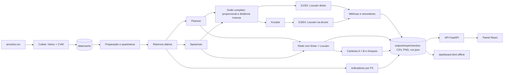

# Rede de FIIs · Análise de Fundos Imobiliários com Grafos

Trabalho de Grafos (SMAC03 · UNIFEI 2026.2 · Cenário 1). O projeto lê preços e informes públicos de FIIs, monta uma rede de similaridade entre os fundos e responde:

- quais FIIs **se comportam de forma parecida**, inclusive de segmentos diferentes;
- se uma carteira **diversificada por segmento** está diversificada de fato;
- quais fundos ocupam **posições centrais** e o que acontece quando um segmento cai;
- qual combinação de **peso e algoritmo** (E1–E4) encontra os melhores grupos.

> Correlação mostra o que andou junto no passado, não causa nem garante o futuro. Os números saem do código; a leitura dos resultados e as conclusões são do grupo.

## Escopo

Organizado pelas fases da metodologia CRISP-NET e pelas etapas 1–10 do checklist do grupo.

| Fase | O que entrega | Status |
|---|---|---|
| **1 · Seleção dos FIIs** | 42 tickers com CNPJ em `config/amostra.csv`, filtros de histórico (90 retornos), cobertura e negociação (80%) | ✅ Concluída (falta documentar a procedência da lista) |
| **2 · Coleta** | Preços ajustados, volume e dividendos (yfinance) e informes mensais da CVM; quarentena de 11 preços conferidos na B3 | ✅ Concluída |
| **3 · Indicadores** | Retorno médio, volatilidade, drawdown, volume financeiro médio, beta, DY, P/VP e segmento por FII | ✅ Implementada (beta usa proxy até subir `config/ifix.csv`) |
| **4 · Correlações** | Pearson e Spearman, comparação par a par, heatmaps | ✅ Implementada |
| **5 · Grafos e pesos** | Rede com limiar, redes direta/inversa por sinal, grafo completo com peso proporcional e com distância inversa | ✅ Implementada |
| **6–7 · Comunidades** | Louvain direto e Kruskal → Louvain na árvore | ✅ Implementada |
| **8 · Experimentos E1–E4** | Modularidade, Silhouette, coesão, estabilidade, tempo e memória, com vencedores | ✅ Implementada · ⏳ rodar com os dados reais |
| **9 · Visualização** | Painel web (React + FastAPI) com rede, E1–E4, árvore, pares, carteiras e indicadores; figuras PNG; `dashboard.html` offline | ✅ Concluída |
| **10 · Relatório e apresentação** | Relatório (até 9 páginas), slides (~15 min), papéis do grupo | ⏳ A fazer |

## Como funciona



| Etapa | O que faz |
|---|---|
| **Coleta** | `coletar.py` baixa preços ajustados, fechamento, volume e proventos de cada ticker e os informes mensais da CVM (segmento, patrimônio, VP por cota, DY). Grava tudo em CSV com hash SHA-256. |
| **Preparação** | Alinha as datas, descarta preço inválido ou dia sem negócio, aplica a quarentena da B3 e calcula o retorno simples. Não preenche lacunas. |
| **Correlações** | Pearson (relação linear) e Spearman (relação por postos, menos sensível a dias extremos). Cada par exige 75 pregões em comum. |
| **Rede com limiar** | Liga dois FIIs quando ρ ≥ 0,35 (rede direta) ou ρ ≤ −0,35 (rede inversa). Serve para centralidade, carteiras e choques. |
| **Grafo completo** | Liga todos os pares com ρ estimável, sem descartar os fracos, com um dos dois pesos do protocolo. |
| **Kruskal** | Árvore geradora mínima sobre a distância d: guarda as N − 1 ligações mais fortes sem formar ciclos. |
| **Louvain** | Agrupa os FIIs maximizando a modularidade (semente fixa, resolução 1). |
| **Carteiras e choques** | A diversifica por segmento, B por comunidade. Forma até 14/11/2025 e avalia depois. Mede o comportamento nos piores dias de Shoppings. |

## Experimentos E1–E4

O professor pediu para não ficar com um método só: definir uma base de comparação, testar variações e mostrar com métricas qual é melhor. O protocolo cruza dois pesos com dois caminhos de detecção e roda tudo com Pearson (base) e Spearman (variação), num total de 8 execuções.

| Exp. | Peso da aresta | Detecção |
|---|---|---|
| **E1** | Proporcional | Louvain no grafo completo |
| **E2** | Distância inversa | Louvain no grafo completo |
| **E3** | Proporcional | Kruskal → Louvain na árvore |
| **E4** | Distância inversa | Kruskal → Louvain na árvore |

**Fórmulas.** Distância d = √(2·(1 − ρ)), que vai de 0 (ρ = 1) a 2 (ρ = −1). Peso proporcional = (1 + ρ)/2, entre 0 e 1. Peso por distância inversa = 1/(d + ε), com ε = 0,05 para evitar divisão por zero.

**Regras de modelagem.**
- Correlações negativas entram com peso pequeno, não são descartadas; Louvain não aceita pesos negativos.
- As duas árvores têm as mesmas arestas, porque os dois pesos crescem com ρ. Muda só o peso que o Louvain recebe.
- Toda partição é medida no **grafo completo** do próprio modelo. Assim E1 e E3 (e E2 e E4) são comparados na mesma régua.

| Métrica | Pergunta que responde | Melhor |
|---|---|---|
| Modularidade no grafo completo | Os grupos têm mais ligação interna do que o esperado ao acaso? | Maior |
| Silhouette (distância d) | Cada FII está mais perto do seu grupo do que do grupo vizinho? | Maior (−1 a 1) |
| ρ médio interno × entre grupos | Os grupos são coesos e separados? | Maior separação |
| Estabilidade entre sementes (ARI) | O Louvain acha os mesmos grupos ao mudar a semente? | Perto de 1 |
| Estabilidade temporal (ARI) | Os grupos da formação se repetem na avaliação? | Perto de 1 |
| ARI × segmento | Os grupos repetem a classificação da CVM? | Só para leitura; um valor baixo é o achado do trabalho |
| Tempo (média ± desvio, 30 repetições) e pico de memória | Quanto custa? | Menor |
| Preservação pela árvore (ARI E1×E3, E2×E4) | A árvore mantém as comunidades do grafo completo? | Perto de 1 |

**Vencedores.** A nota de qualidade é a média normalizada de modularidade, Silhouette e estabilidade. A nota de custo é a média de tempo e memória. O equilíbrio vale 70% qualidade e 30% custo, porque com 40 FIIs todos os métodos rodam em milissegundos.

**Como ler.** Em grafo completo e denso, a modularidade fica baixa (perto de 0,02) mesmo com grupos bons; compare os experimentos entre si, não com o 0,3 dos livros. Na árvore, o Louvain tende a quebrar em mais grupos; a modularidade da própria árvore (`modularidade_estrutura`) é alta e **não** deve ser usada para comparar.

## Painel web (React + FastAPI)

O painel lê os resultados de `outputs/experimentos/` pela API e permite rodar uma nova análise sem sair do navegador.

| Aba | O que mostra |
|---|---|
| **Rede** | Rede direta (ρ ≥ τ) ou inversa (ρ ≤ −τ); cor = comunidade, formato = segmento; busca, zoom e clique para abrir o perfil do FII |
| **Experimentos E1–E4** | Vencedores (qualidade, custo, equilíbrio), tabela das 8 execuções com o melhor de cada coluna em verde, quanto a árvore preserva as comunidades e as figuras do protocolo |
| **Árvore de Kruskal** | A árvore colorida pela rede com limiar ou pelos grupos de E1, E2, E3 ou E4, com distâncias opcionais |
| **Pares** | Pares mais correlacionados, com filtro "só segmentos diferentes", Pearson × Spearman e relações opostas |
| **Carteiras** | Retorno acumulado de A (por segmento) × B (por comunidade), métricas lado a lado e composição |
| **Indicadores** | Tabela ordenável da etapa 3: retorno, volatilidade, drawdown, beta, DY, P/VP, volume e patrimônio |

O perfil do FII (ao lado da rede e da árvore) mostra indicadores, a comunidade em cada experimento e os pares mais correlacionados, com os de outro segmento em laranja.

| Rota da API | Conteúdo |
|---|---|
| `GET /api/summary` | Resumo da execução e vencedores E1–E4 |
| `GET /api/network?relation=direct\|inverse` | Nós com posições e arestas |
| `GET /api/tree?color=louvain\|E1…E4` | Árvore com posições e cores |
| `GET /api/protocol` | Tabela E1–E4, vencedores e preservação |
| `GET /api/pairs`, `/api/funds/{ticker}`, `/api/indicators`, `/api/portfolios` | Tabelas do painel |
| `POST /api/analyze?tau=0.35&repeats=5` | Roda a análise em segundo plano; acompanhe em `GET /api/analyze/status` |

Documentação interativa de todas as rotas em `http://127.0.0.1:8000/docs`.

## Saídas

Tudo vai para `outputs/experimentos/` (análise completa) ou `outputs/simples/` (análise rápida).

| Arquivo | O que mostra |
|---|---|
| **dashboard.html** | Painel offline: redes direta e inversa, busca por ticker, comunidades, pares e tabela E1–E4. Abre sozinho ao terminar. |
| **protocolo_e1_e4/e1_e4.csv** | As 8 execuções com todas as métricas, notas e vencedores |
| **protocolo_e1_e4/particoes_pearson.png** | E1–E4 lado a lado sobre a mesma árvore; cor = comunidade, formato = segmento |
| **protocolo_e1_e4/protocolo_metricas.png** | Modularidade, Silhouette, estabilidade e tempo por experimento |
| **indicadores_fundos.csv** | Tabela consolidada da etapa 3, um FII por linha |
| **pearson_vs_spearman.csv / .png** | Diferença entre as duas correlações por par, maiores divergências primeiro |
| **matriz_correlacao.png / matriz_spearman.png** | Mapas de calor |
| **fund_profiles.csv, pairs.csv** | Perfil, comunidade e centralidade de cada FII; todos os pares com atributos |
| **portfolio_metrics.csv, carteiras.png** | Carteira A (segmento) × B (comunidade) fora da amostra |
| **shock_exposures.csv, choques.png** | Comportamento nos piores dias do segmento escolhido |
| **comparacao_modelos/** | Pearson × peso composto (60% ρ, 20% segmento, 20% faixa de patrimônio) |
| **run.json** | Parâmetros, versões, cobertura, vencedores E1–E4 e limitações |

## Estrutura

```
backend/           API FastAPI do painel
frontend/          painel React (src/App.jsx e src/components/)
config/            amostra de FIIs, auditoria B3, quarentena e (opcional) ifix.csv
data/cache/        snapshot dos dados coletados, para rodar offline
docs/              metodologia, resultados de referência e roteiro da apresentação
tests/             27 testes com dados sintéticos (análise, protocolo e API)
coletar.py         baixa os dados
main.py            roda a análise (rápida ou completa)
fii_network.py     CLI com mais opções (collect, analyze, inspect)
fonte_yfinance.py  coleta, cache, preparação e qualidade
grafo_base.py      correlações, distâncias, pesos, redes e centralidades
algo_louvain.py    Louvain
algo_mst.py        Kruskal com union-find
protocolo.py       experimentos E1–E4 e métricas
indicadores.py     indicadores por FII
experimentos.py    orquestra a análise completa
carteiras_choques.py, comparacao_modelos.py, visualizacao.py, dashboard.py
```

## Como rodar

Python 3.11 ou superior.

**Instalação (uma vez)**

```bash
git clone https://github.com/juliocpaiva/trabalho-de-grafos---analise-de-fii.git
cd trabalho-de-grafos---analise-de-fii
python -m venv .venv
source .venv/bin/activate          # Windows: .\.venv\Scripts\activate
pip install -e ".[test]"
```

**Dados.** Se `data/cache/` já estiver no repositório, pule para a análise. Se não, colete (precisa de internet, leva alguns minutos):

```bash
python coletar.py
```

**Análise**

```bash
python main.py --experimentos                 # completa: E1–E4, carteiras, choques e painel
python main.py                                # rápida: rede, Kruskal e painel
python main.py --experimentos --repeticoes 5  # versão rápida do protocolo, para testar
python -m fii_network inspect HGLG11 --output outputs/experimentos   # consulta um FII
python -m pytest -q                           # testes
```

Opções úteis: `--limiar 0.45` muda o corte da rede, `--saida outputs/teste` grava em outra pasta, `--sem-navegador` não abre o `dashboard.html`. No VS Code, as mesmas tarefas estão em **Terminal → Executar Tarefa** (usam o Python escolhido em *Python: Select Interpreter*, em Windows, WSL ou Linux).

**Painel web.** Precisa do Node.js LTS (no WSL/Ubuntu: `sudo apt install -y nodejs npm`, ou `nvm install --lts`).

```bash
cd frontend && npm install && npm run build && cd ..   # compila o painel (uma vez e após mudar o front)
uvicorn backend.main:app --host 127.0.0.1 --port 8000  # abra http://127.0.0.1:8000
```

Para desenvolver o front com atualização automática, rode a API num terminal e `cd frontend && npm run dev` noutro; abra `http://localhost:5173`. No VS Code, as tarefas **FIIs: 6**, **7** e **8** fazem o mesmo.

**Beta contra o IFIX.** O Yahoo não fornece o IFIX. Baixe a série no site da B3 (Índices → IFIX → Estatísticas históricas) e salve como `config/ifix.csv` com as colunas `date,close`. Sem esse arquivo, o beta usa a média igual da amostra e a tabela avisa isso na coluna `beta_referencia`.

## Como colaborar

**Antes de mexer:** `git pull` na sua branch e rode `python -m pytest -q`.

**Depois de mexer:**

```bash
git checkout -b sua-branch          # nunca direto na main
python -m pytest -q                 # tem que passar tudo
git add arquivos_alterados
git commit -m "O que mudou"
git push -u origin sua-branch       # e abra um Pull Request para a main
```

- Um assunto por branch: `feat/...` para código novo, `docs/...` para texto. Antes de abrir o PR, faça `git merge origin/main` para não divergir como aconteceu com `Testes-Rodrigo`.
- Toda função nova ganha um teste em `tests/` com dados sintéticos em que a resposta é conhecida.
- Para comparar execuções, grave em pastas diferentes (`--saida`) e confira o `run.json` de cada uma.
- **Suba** `data/cache/` (o snapshot de referência) e `config/`. **Não suba** `outputs/`, `.venv/`, `data/coleta_api/`, `frontend/node_modules/` nem `frontend/dist/`.

## Limitações

- Correlação histórica: mostra associação, não causa, e muda com o período (a estabilidade temporal medida foi baixa).
- Amostra intencional de 42 FIIs, não todo o mercado; pode haver viés de sobrevivência.
- Segmento é o declarado à CVM, inclusive categorias amplas como "Multicategoria".
- Carteiras com pesos iguais, sem custos nem impostos; a escolha do universo foi retrospectiva.
- Yahoo Finance tem falhas pontuais; os preços contestados ficam em quarentena com evidência da B3.

## Pendências

- [x] Coleta, preparação e quarentena dos preços.
- [x] Pearson, rede com limiar, Louvain, Kruskal, centralidades, carteiras e choques.
- [x] Redes direta e inversa e painel interativo.
- [x] Spearman e comparação com Pearson.
- [x] Pesos proporcional e distância inversa no grafo completo.
- [x] Louvain na árvore de Kruskal e protocolo E1–E4 com métricas.
- [x] Indicadores por FII (retorno, drawdown, volume médio, beta).
- [x] Painel React + FastAPI com abas de rede, E1–E4, árvore, pares, carteiras e indicadores; análise em segundo plano.
- [ ] Subir `data/cache/` para o Git, para qualquer um rodar offline.
- [ ] Baixar o IFIX da B3 para `config/ifix.csv`.
- [ ] Rodar `python main.py --experimentos` com os dados reais e registrar os vencedores em `docs/resultados_referencia.md`.
- [ ] Documentar a procedência da lista de 42 FIIs.
- [ ] Relatório no template oficial (até 9 páginas, introdução de 1 página).
- [ ] Slides de ~15 min e roteiro da demonstração.
- [ ] Preencher a tabela de equipe abaixo e `docs/responsabilidades.md`.

## Equipe

| Nome | Papel |
|---|---|
| Júlio | Desenvolvimento: base da análise, coleta, Kruskal e Louvain |
| Rodrigo Braz | Desenvolvimento: redes por sinal e painel interativo |
| Thiago | Desenvolvimento: painel React e API FastAPI |
| A preencher | Orador |
| A preencher | Modelagem |
| A preencher | Modelagem |

---
SMAC03 · UNIFEI · 2026
